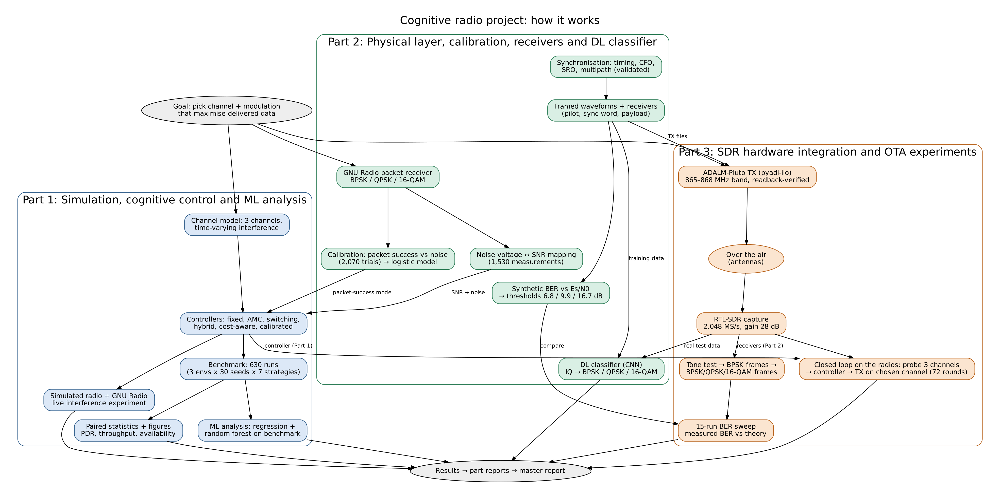

# Cost-Aware Cognitive Radio: Joint Channel Switching and Adaptive Modulation

A cognitive radio that chooses, at every step, **which channel** to use and **which modulation** (BPSK, QPSK or 16-QAM) to send on it. It weighs data rate against the probability that a packet succeeds and against the time lost when switching channel. The project combines simulation, a GNU Radio physical layer, an over-the-air SDR link (ADALM-Pluto → RTL-SDR) and ML/DL analysis.



## Headline results

| Area | Result |
|---|---|
| Controller benchmark (630 runs: 3 environments × 30 seeds × 7 strategies) | The calibrated hybrid gives the highest throughput in every interference environment (3.999 / 3.684 / 2.986 bits per step at low / medium / high) with PDR ≥ 0.99; every paired 95 % CI against the plain hybrid excludes zero |
| Packet-success calibration (GNU Radio, 2,070 trials) | Logistic models per modulation, leave-one-seed-out accuracy 98–99.9 % |
| Over-the-air link, 866 MHz (19 runs) | BPSK, QPSK and 16-QAM BER with exact 95 % CIs; implied implementation loss −0.2 to +0.75 dB vs AWGN theory above 4 dB Es/N0; the switching thresholds (6.8 / 9.9 / 16.7 dB) hold on air |
| Sensitivity and robustness | The calibrated hybrid leads at every switching penalty 0–0.6 (0.25 is better than the 0.15 used); with a 1 dB implementation loss it still leads, and a 1 dB safety margin keeps PDR at 0.997 / 0.988 (medium / high) |
| DL modulation classifier (CNN) | Trained only on simulation; **98.5 %** of 536 real OTA windows (capture-level 95 % CI 96.2–99.8 %), 19/19 captures, 36/36 windows of an unseen frame format (classical baseline: 62.9 %) |
| ML on the benchmark (random forest) | R² 0.997 (throughput), 0.985 (PDR) on held-out seeds |
| Tests | 355 |

## The three parts

| Part | Scope | Report |
|---|---|---|
| 1. Simulation, cognitive control and ML | Channel model, 7 controller strategies, 630-run benchmark, paired statistics, simulated radio, GNU Radio software-in-the-loop experiment, ML analysis | `docs/reports/Part1_Simulation_Control_ML_Report.docx` |
| 2. Physical layer, calibration, receivers and DL | GNU Radio packet receiver, packet-success and SNR calibration, synchronisation, on-air frames and receivers, BER thresholds, CNN classifier | `docs/reports/Part2_PHY_Calibration_Receivers_DL_Report.docx` |
| 3. SDR hardware and OTA experiments | Pluto / RTL-SDR drivers, safety gates, experiment runner, tone test, BPSK frames, BER sweep | `docs/reports/Part3_SDR_Hardware_OTA_Report.docx` |

The whole project is summarised in `docs/reports/Master_Report.docx`. Code-to-output flowcharts are in `docs/flowcharts/`; the documentation index is `docs/README.md`.

## Repository layout

```text
src/                 channel model, controllers, benchmark, ML analysis, sync, SDR drivers
  radio/             waveforms, frames, receivers, Pluto / RTL-SDR interfaces
  dl/                CNN modulation classifier
gnuradio/            GNU Radio packet receiver, calibration and control-path experiments
experiments/         GNU Radio software-in-the-loop interference experiment
scripts/             OTA experiment runner, BER curves, DL training, flowcharts, summaries
pipelines/           integrated software pipeline (RF path disabled)
tests/               355 tests
results/             datasets, figures, analysis tables, OTA captures (results/hardware/), DL results (results/dl/)
data/                RTL-SDR capture dataset
docs/                reports, flowcharts, reference documents
```

## Setup

Developed on Arch Linux with Python 3.12 (miniforge3 conda environment) and GNU Radio 3.10.

```bash
conda create -n cognitive-radio -c conda-forge python=3.12 gnuradio gnuradio-iio
conda activate cognitive-radio
pip install -r requirements.txt
python -m pytest -q tests              # 355 passed
```

pyadi-iio needs a Python libiio binding that matches the system libiio: with libiio 0.x (e.g. 0.26) use `pylibiio==0.25`. Hardware runs also need the `rtl_sdr` and `iio_attr` command-line tools.

## Reproducing the results

```bash
export PYTHONPATH=.
python src/multi_seed_experiment.py                         # 630-run benchmark
python src/paired_seed_analysis.py > results/paired_seed_analysis_current.txt
python src/ml_analysis.py                                   # -> results/ml/
python scripts/ber_curves.py && python scripts/plot_ber_synthetic.py
python scripts/summarize_hardware_sweep.py                  # OTA BER table + figure from the saved runs
python scripts/train_modulation_classifier.py               # CNN, about 8 min on a laptop CPU
python scripts/evaluate_dl_strict.py                        # capture-level CI, confidence, unseen format
python scripts/sensitivity_analysis.py                      # penalty sweep, implementation loss, margin (~30 min)
python scripts/make_flowcharts.py                           # needs graphviz
node docs/reports/build_reports.js                          # part reports (needs: npm install docx)
```

Any saved OTA capture can be decoded again without hardware:

```bash
python scripts/run_hardware_experiment.py \
    --rx-file results/hardware/captures/rx_20261123_135940.cu8 \
    --waveform results/baseband/multimod_v2/qpsk_framed_seed42.json --no-save
```

## Transmitting

RF transmission is off by default. `scripts/run_hardware_experiment.py` transmits only with `--enable-rf`, a declared RF path (`--rf-path ota --antenna-separation-m D`, or `conducted` with ≥ 30 dB of attenuation), an occupied band inside 865–868 MHz, the operator typing `TRANSMIT`, and a successful Pluto readback. See `docs/TRANSMISSION_DAY_RUNBOOK.md`. Check the regulations that apply where you transmit.

## Limitations

The controller is evaluated in simulation; the hardware work is open-loop (closed loop removed from scope). The OTA evidence comes from one session at one frequency with 4,096 bits per point. Details: `docs/LIMITATIONS.md`.
